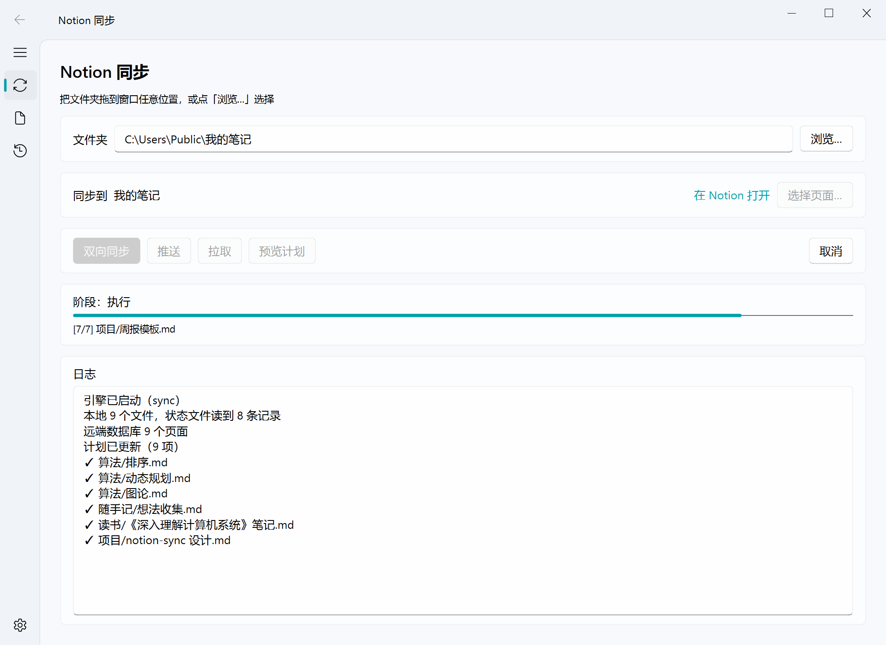
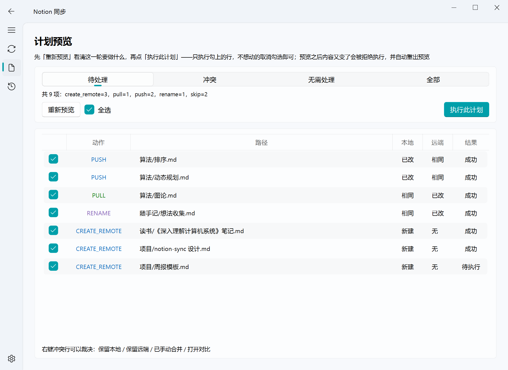
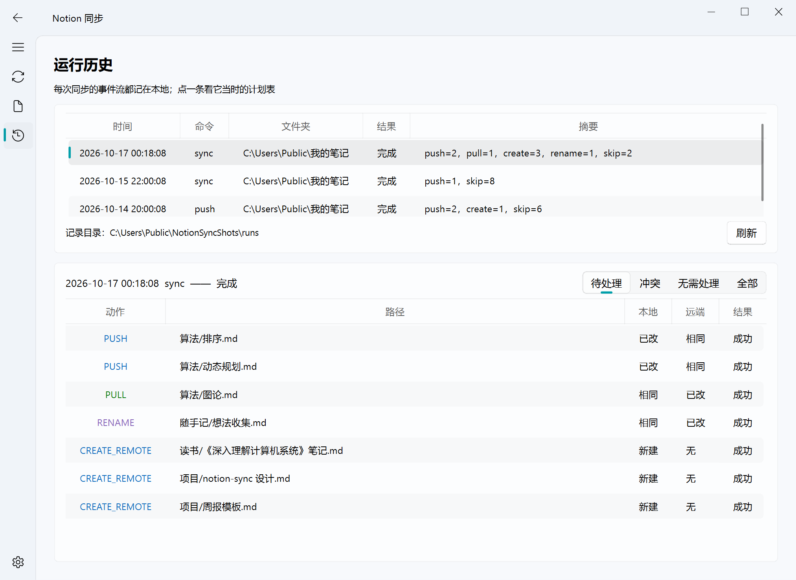
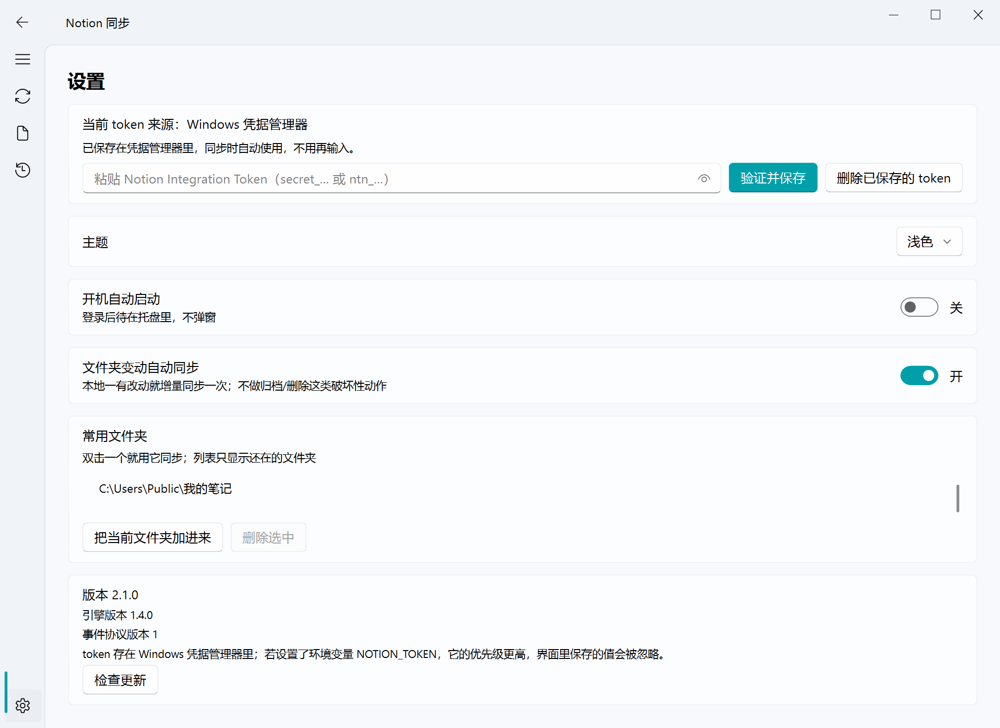

# NotionSync

把本地文件夹和 Notion 双向同步的 Windows 桌面应用。

选一个文件夹、选一个 Notion 页面，它会在那个页面下建一个数据库，把文件夹里的
Markdown 文件映射成一条条页面。之后两边的改动互相同步：本地新写的文件推上去，
Notion 上改过的内容拉下来。



## 功能

**同步前先出计划。** 每一轮要做什么——推送、拉取、新建、改名、跳过——都先列成一张表，
可以只勾选其中几行执行。计划列出来之后如果内容又变了，这一轮会被拒绝执行并重新预览，
不会照着过期的计划动手。

**冲突不替你决定。** 两边都改过的文件会停下来标成冲突，等你选「保留本地 / 保留远端 /
已手动合并」，裁决前会先把远端内容落盘备份一份。

**文件夹一改就同步。** 监听打开后，本地一有改动就自动跑一次增量同步；自动运行不做
归档、删除这类破坏性动作（有上限闸），要做这些得自己点。

**每次运行都留档。** 同步的事件流原样记在本地，历史页可以翻回任意一次，看它当时的
计划表和每个文件的结果。

**检查更新。** 启动时静默查一次 GitHub Releases，有新版本才提示；设置页里也可以手动查。

## 截图

### 计划预览

按动作分段筛选，勾选要执行的行；右键冲突行可以就地裁决。



### 运行历史



### 设置



## 安装

到 [Releases](https://github.com/Britneycode/NotionSync/releases) 下载最新的
`NotionSync-Setup-<版本>.exe` 双击安装。

- 装在当前用户目录下，**不需要管理员权限**。
- 桌面快捷方式和开机自启默认都不勾；想开可以在安装向导里勾，也可以装完在设置页里改。
- 升级直接装新版本覆盖即可。同步配置和运行历史在 `%LOCALAPPDATA%\NotionSync\` 下，
  卸载前一直保留。

## 开始使用

### 1. 建一个 Notion Integration

到 <https://www.notion.so/my-integrations> 新建一个 internal integration，拿到
token（`ntn_…` 或 `secret_…`）。这个 token 决定同步程序能看见哪些页面。

### 2. 把目标页面授权给它

在 Notion 里打开你想同步到的那一级页面 → 右上角 `···` → 「连接」→ 选中刚才那个
integration。**没做这一步的话，程序在 Notion 里什么都看不见。**

### 3. 把 token 存进设置页

打开 NotionSync → 设置 → 粘贴 token → 「验证并保存」。token 存在 Windows 凭据管理器里，
不落盘、不写进配置文件。也可以改用环境变量 `NOTION_TOKEN`（优先级更高）。

### 4. 选文件夹、选目标页面

回到「同步」页，选一个本地文件夹，点「选择页面…」挑第 2 步授权的那个页面，确认后
程序会在它下面建好数据库。

### 5. 同步

点「双向同步」。想先看看会动什么，就点「预览计划」——它只算不动。

## 命令行

引擎是独立的一层，不带界面也能用：

```bash
uv run notion-sync sync --root "D:\我的笔记" --json
```

装好的包里也有 `notion-sync.exe`。命令有 `init` / `status` / `push` / `pull` / `sync` /
`resolve` / `forget` / `pages`，`--json` 输出 JSON Lines 事件流。

## 开发

需要 Python 3.12+ 和 [uv](https://docs.astral.sh/uv/)。

```bash
uv sync
```

```bash
uv run pytest
```

```bash
uv run ruff check
```

```bash
uv run notion-sync-desktop
```

## 构建安装包

先打包出 `dist/NotionSync/`，再把它编译成安装包：

```bash
uv run pyinstaller packaging/notion-sync.spec --noconfirm
```

```bash
"$LOCALAPPDATA/Programs/Inno Setup 6/ISCC.exe" packaging/installer.iss
```

产物是 `dist/installer/NotionSync-Setup-<版本>.exe`（约 43 MB）。**每次都要先重建
`dist/NotionSync/` 再编译**——`installer.iss` 是直接打包那个目录的，忘了重建就会把旧的
exe 装进去。

发版要同时改五处版本号：`apps/desktop/pyproject.toml`、
`apps/desktop/src/notion_sync_desktop/__init__.py`、`packages/notion-sync-engine/pyproject.toml`、
`packages/notion-sync-engine/src/sync_lib/__init__.py`、`packaging/installer.iss` 的
`AppVersion`。`apps/desktop/tests/test_version.py` 把它们钉成一致。

## 重新生成 README 里的截图

```bash
uv run --project apps/desktop python tools/make_screenshots.py
```

脚本不开真窗口，界面内容全部经真实入口灌入（协议事件走主窗口的事件分发，历史由真实的
写入器落盘后读回），跑完把示例文件夹删掉。

## 目录结构

| 路径 | 内容 |
|---|---|
| `packages/notion-sync-engine/` | 同步引擎：状态与计划、Notion API 交互、CLI |
| `apps/desktop/` | 桌面界面（PySide6 + PySide6-Fluent-Widgets） |
| `packaging/` | PyInstaller spec 与 Inno Setup 安装脚本 |
| `tools/` | 辅助脚本 |

界面不直接调 Notion API：它把引擎当子进程跑，读它 stdout 上的 JSON Lines 事件流拿进度
和结果，反过来用 stdin 发取消、勾选清单这类控制命令。
